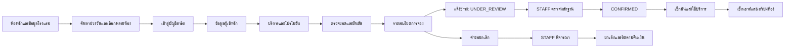

# โครงสร้างหน้า เมนู และการเชื่อมโยงข้อมูล

ใช้ HTML shell เดียวและ JavaScript hash routes แต่แยก HTML/CSS/JS/SQL เป็นไฟล์ ไม่ใช้ React/Vue/Angular แท็บหน้าที่อ้างอิง 1–6 รวมเป็นหน้าข้อมูลโรงแรม หน้าเช็กเอาต์เป็น 3 ขั้นตอนตามงานจริง

| Route | เมนู | ผู้ใช้ |
|---|---|---|
| `#home` | โรงแรม แกลเลอรี ค้นหา/เลือกห้อง บริการและนโยบาย | ทุกคน |
| `#login` | เลือกบัญชีจำลอง; USER 2 คน, STAFF, ADMIN | ทุกคน |
| `#book` | ข้อมูลลูกค้า → บริการ/โปรโมชั่น → ยืนยัน | USER / STAFF / ADMIN |
| `#bookings` | รายการของตน; พนักงานเห็นรายการรวม | USER / STAFF / ADMIN |
| `#booking/:id` | รายละเอียด ชำระ ยกเลิก ประวัติ; ปุ่มงานตามสิทธิ์ | เจ้าของ / STAFF / ADMIN |
| `#staff` | Dashboard งานวันนี้ | STAFF / ADMIN |
| `#staff/bookings` | ค้นหาและจัดการการจอง | STAFF / ADMIN |
| `#staff/payments` | รายการหลักฐานรอตรวจ | STAFF / ADMIN ตามสิทธิ์ |
| `#staff/cancellations` | คำขอรอพิจารณา | STAFF / ADMIN ตามสิทธิ์ |
| `#staff/rooms` | สถานะห้องและยืนยันเตรียมห้อง | STAFF / ADMIN |
| `#staff/stays` | ประวัติเข้าพักจริงและลิงก์บริการ | STAFF / ADMIN |
| `#admin/customers` | เพิ่ม/แก้ไข/ปิดใช้ลูกค้า | ADMIN |
| `#admin/employees` | เพิ่ม/แก้ไข/ปิดใช้พนักงานและ SYSTEM_ROLE | ADMIN |
| `#admin/rooms` | ห้อง หมายเลข ชั้น ประเภท สถานะ | ADMIN |
| `#admin/roomTypes` | ประเภท ราคา เตียง ความจุ พื้นที่ | ADMIN |
| `#admin/services` | บริการ ราคา สถานะ | ADMIN |
| `#admin/promotions` | ช่วงวัน ส่วนลดและเงื่อนไข | ADMIN |
| `#admin/maintenance` | กำหนดช่วงปิดซ่อม ค้นหา/กรอง/แบ่งหน้าประวัติ | ADMIN |

## ฟังก์ชัน → ตาราง → Query/Transaction → สิทธิ์

ชื่อ Q อ้าง `03_queries.sql`; ชื่อ procedure อ้าง `04_transactions.sql`; การจัดการข้อมูลหลักใช้ GINGER_MANAGEMENT ใน `08_admin_transactions.sql`; Backend ต้อง bind และ validate

| ฟังก์ชัน | ตาราง | Query / Transaction | สิทธิ์ |
|---|---|---|---|
| ค้นหาห้อง/กรอง | ROOMS, ROOM_TYPES, BOOKINGS, BOOKING_ROOMS, PAYMENTS, ROOM_MAINTENANCE* | Q01 | ทุกคน |
| ข้อมูลติดต่อ | CUSTOMERS, CUSTOMER_EMAILS, CUSTOMER_PHONES | Q11/Q14 / GINGER_MANAGEMENT.UPDATE_PROFILE | เจ้าของ / ADMIN; STAFF เพิ่มลูกค้าตอน walk-in |
| แสดงบริการ | SERVICES | Q02 | ทุกคน |
| โปรโมชั่นผ่านเงื่อนไข | PROMOTIONS | Q03 / CREATE_BOOKING ตรวจซ้ำ | ทุกคน |
| สร้างจองหลายห้อง | BOOKINGS, BOOKING_ROOMS, SERVICE_USAGE, PAYMENTS, master ราคา | CREATE_BOOKING | USER ของตน / STAFF แทนลูกค้า / ADMIN |
| ประวัติการจอง | BOOKINGS, CUSTOMERS, BOOKING_ROOMS | Q04, Q05 | เจ้าของ / STAFF / ADMIN |
| แจ้งชำระ/หลักฐาน | PAYMENTS, BOOKINGS | SUBMIT_PAYMENT, Q06 | เจ้าของ / STAFF / ADMIN |
| ตรวจรับชำระ | PAYMENTS, BOOKINGS, AUDIT_LOG* | REVIEW_PAYMENT | STAFF ที่ได้รับสิทธิ์ / ADMIN |
| งานเข้าออกวันนี้ | BOOKINGS, PAYMENTS, CANCELLATION_REQUESTS* | Q07, Q12 | STAFF / ADMIN |
| เช็กอิน | STAY_HISTORY, BOOKINGS, ROOMS | CHECK_IN | STAFF / ADMIN |
| เช็กเอาต์ | STAY_HISTORY, BOOKINGS, ROOMS, PAYMENTS, SERVICE_USAGE | CHECK_OUT | STAFF / ADMIN |
| เตรียมห้อง | ROOMS, STAY_HISTORY, BOOKING_ROOMS | PREPARE_ROOM | STAFF / ADMIN |
| ประวัติจริง/บริการ | STAY_HISTORY, SERVICE_USAGE, SERVICES, BOOKINGS | Q08, Q09 | เจ้าของ / STAFF / ADMIN |
| เพิ่ม/ใช้บริการ | SERVICE_USAGE, SERVICES, BOOKINGS | ADD_SERVICE, RESOLVE_SERVICE | STAFF / ADMIN |
| ส่งคำขอยกเลิก | CANCELLATION_REQUESTS*, BOOKINGS | REQUEST_CANCELLATION | เจ้าของ / STAFF / ADMIN |
| อนุมัติ/ปฏิเสธยกเลิก | CANCELLATION_REQUESTS*, CANCELLATIONS, BOOKINGS, SERVICE_USAGE, REFUNDS* | REVIEW_CANCELLATION, Q10 | STAFF ที่ได้รับสิทธิ์ / ADMIN |
| บันทึกคืนเงินจริง | REFUNDS*, CANCELLATIONS | COMPLETE_REFUND | ADMIN |
| ปิดรายการหมดอายุ | BOOKINGS, PAYMENTS, SERVICE_USAGE, CANCELLATION_REQUESTS* | EXPIRE_BOOKING | งานระบบผ่านบัญชีพนักงานที่กำหนด |
| พนักงานและสิทธิ์ | EMPLOYEES, EMPLOYEE_EMAILS, EMPLOYEE_PHONES, WEB_ACCOUNTS* | Q11/Q15 / GINGER_MANAGEMENT.SAVE_MASTER | ADMIN |
| ข้อมูลหลักห้อง/บริการ/โปร | ROOMS, ROOM_TYPES, SERVICES, PROMOTIONS | Q11/Q15 / GINGER_MANAGEMENT.SAVE_MASTER | ADMIN |
| ช่วงปิดซ่อม | ROOM_MAINTENANCE*, ROOMS, BOOKINGS, BOOKING_ROOMS | Q13 / SCHEDULE_MAINTENANCE | ADMIN กำหนด; STAFF/ADMIN อ่าน |
| login/logout | WEB_ACCOUNTS*, CUSTOMERS, EMPLOYEES | Backend auth (ยังไม่ได้ติดตั้ง); Demo ใช้ตัวเลือกบทบาท | เจ้าของบัญชี |
| audit | AUDIT_LOG* | เพิ่มโดย helper ใน transaction เดียว | Backend / ADMIN อ่าน |

`*` คือส่วนเพิ่มที่เสนอ ไม่ใช่การอ้างว่ามีใน Schema ต้นฉบับ

## กติกาธุรกิจชุดเดียวกัน

- ใช้ Asia/Bangkok; วันจองเป็น DATE เที่ยงคืน; จำนวนคืน = check_out − check_in; 1–30 คืน; 1–10 ห้อง; ผู้เข้าพักอย่างน้อย 1 คนต่อห้องและไม่เกินผลรวมความจุ
- เช็กอินวันเริ่มจองตั้งแต่ 14:00; ต้อง CONFIRMED ทุกห้อง AVAILABLE ไม่มีประวัติเข้าพักค้าง และชำระครบ; เช็กเอาต์ก่อนกำหนดได้ โดยบันทึกเวลาจริง ไม่คืนค่าคืนที่เหลืออัตโนมัติ
- เช็กเอาต์ตามนโยบายภายใน 12:00; โครงงานไม่คิดค่าปรับล่วงเวลาอัตโนมัติ; รายการเลยกำหนดแสดงให้พนักงานดำเนินการและบล็อกค้นหาเข้าวันนี้จนเช็กเอาต์
- จองล่วงหน้าไม่เปลี่ยนสถานะห้องเป็น OCCUPIED; เช็กเอาต์เปลี่ยนเป็น CLEANING แล้วพนักงานต้องยืนยันเตรียมห้อง
- ชำระเต็มจำนวน; PENDING_PAYMENT หมดอายุ 24 ชั่วโมง ถ้ายังไม่มี UNDER_REVIEW; ส่งหลักฐานทันเวลาจะกันห้องจนตรวจเสร็จ; ปฏิเสธให้แก้ไขอีก 2 ชั่วโมง; STAFF ต้องติดตามคิวที่ค้าง ไม่มี transaction ค้างระหว่างรอ
- ส่วนลดใช้ค่าห้องเท่านั้น 0 < percent < 100; วัดช่วงโปรโมชั่นจากวันทำจอง; minimum nights และยอดค่าห้องก่อนลด; มีได้ 1 โปรต่อการจอง
- roomAmount = Σ agreedPricePerNight × nights; serviceAmount = Σ quantity × unitPriceAtUse; discount = ROUND(roomAmount × percent / 100, 2); total = roomAmount + serviceAmount − discount; paid = SUM(PAID); balance = total − paid
- บริการที่เพิ่มหลังจองทำให้ serviceAmount/total เพิ่ม และเกิดยอดค้างใหม่; ไม่แก้ยอด PAID เดิม; การไม่ใช้แพ็กเกจที่ตกลงไว้ยังคิดราคาเดิมตามเงื่อนไขที่แสดงก่อนยืนยัน ต้อง resolve PLANNED ทุกอันก่อนเช็กเอาต์
- หากมีหลักฐาน UNDER_REVIEW ต้องตรวจให้เสร็จก่อนเพิ่มบริการใหม่ เพื่อไม่ให้ยอดที่ตรวจอยู่เปลี่ยนกลางทาง
- ขอยกเลิกได้ก่อนเช็กอิน; คำขอไม่ปล่อยห้องทันที; พนักงานตรวจยอดรอพิจารณาก่อนอนุมัติ; ขออย่างน้อย 48 ชั่วโมงก่อนเช็กอิน 14:00 คืนยอด PAID ทั้งหมด เมื่ออนุมัติ; น้อยกว่า 48 ชั่วโมงคืน 0; REFUND_AMOUNT ไม่เท่ากับโอนเงินคืนสำเร็จ
- คำขอยกเลิกค้างที่การจองหมดอายุก่อนจะถูกปฏิเสธโดยระบบพร้อมเหตุผล
- ไม่มีการจัดการหลายโรงแรม เที่ยวบิน รถเช่า Social Login แผนที่หรือรีวิวสมมติ

## Transaction และการล็อก

`BEGIN` เริ่ม PL/SQL block ไม่ใช่ START TRANSACTION การเปลี่ยนข้อมูลเริ่ม transaction ตามการทำ DML/ล็อกของ Oracle แต่ละ public procedure ใน GINGER_API และ GINGER_MANAGEMENT เป็นขอบเขตงานหนึ่งรายการและรับผิดชอบ COMMIT/ROLLBACK ทั้งชุด Backend ต้องใช้ connection ที่ไม่มีงานอื่นค้าง ห้ามเรียกหลาย public procedures แล้วคาดว่าจะย้อนกลับทั้งกลุ่มได้

Private helpers ไม่ COMMIT ไม่มี autonomous audit transaction ทุกกระบวนการเกี่ยวกับห้องใช้ ROOMS เรียง ROOM_ID ก่อน BOOKINGS แล้วจึง payment/request/usage/refund; การจองใหม่ล็อก room types, services และ promotion ก่อนอ่านราคาสำหรับ snapshot; admin ห้ามล็อก master ก่อนแล้วย้อนกลับมาขอล็อกห้อง

จัด job เรียก EXPIRE_BOOKING ทีละ booking ที่มีสิทธิ์และหมดเวลา แต่ Q01 และ CREATE_BOOKING ไม่พึ่ง job อย่างเดียว: pending ที่หมดเวลาและไม่มี UNDER_REVIEW ไม่กีดกันห้องอยู่แล้ว การชำระ late ต้องถูกปฏิเสธใน transaction ของ submit

Oracle อธิบายว่าการล็อก FOR UPDATE ปล่อยเมื่อ COMMIT/ROLLBACK ดู [Transaction Processing and Control](https://docs.oracle.com/en/database/oracle/oracle-database/19/lnpls/transaction-processing-and-control.html) ส่วนการแปลงรายการห้อง/บริการใช้ [JSON_TABLE](https://docs.oracle.com/en/database/oracle/oracle-database/19/sqlrf/JSON_TABLE.html) นี่เป็นเหตุผลที่เลือกให้การตรวจห้องซ้ำและบันทึกอยู่ในขอบเขต transaction เดียวกัน

ส่วน Schema หลักยึด Normalize.pdf และใช้ DELETED_AT เฉพาะตารางที่มีเดิม ดู SCHEMA-REVIEW.md สำหรับรายชื่อและส่วนเพิ่มทั้งหมด STAFF ที่ถูกเพิกถอน canReviewPayments/canReviewCancellations ยังทำงานหน้าเคาน์เตอร์ได้ แต่พิจารณารายการที่ไม่ได้รับสิทธิ์ไม่ได้
